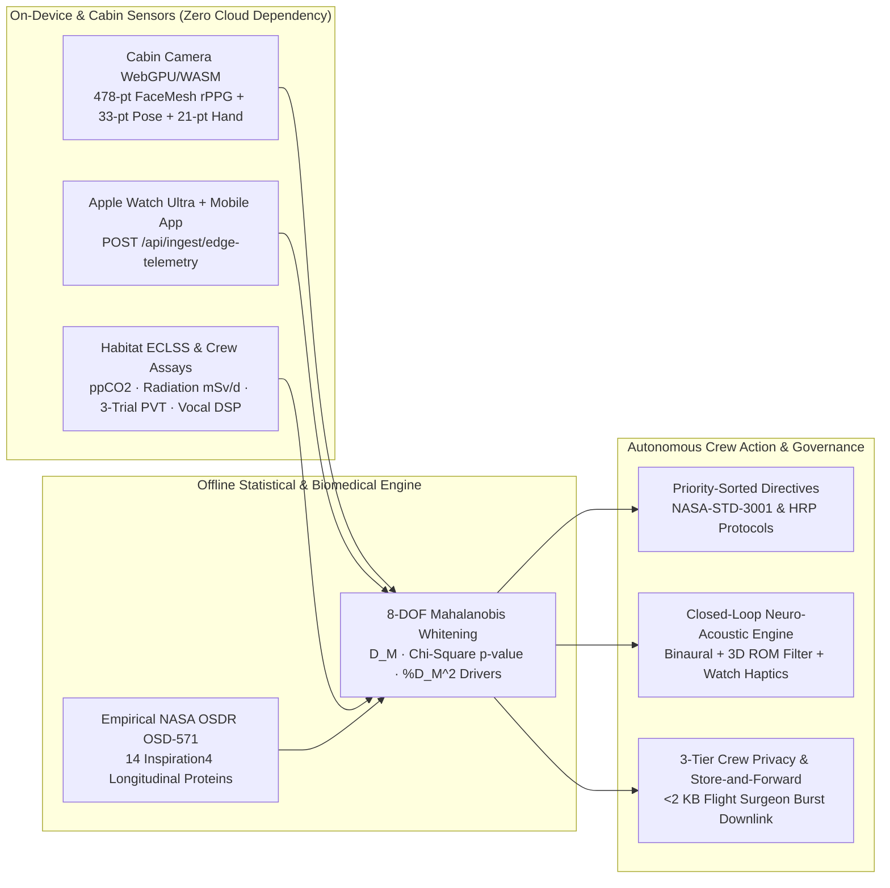

# AstroKinetics · ASTRA (`v5.0.0`) — Unified Spaceflight Showcase, Guided Watch/iPhone Demo, Grok Voice AI & 3D Crew Health Suite

[](https://astrokinetics-space-health-765428358644.us-central1.run.app)
[](https://astrokinetics-space-health-765428358644.us-central1.run.app/demo/#demo)
[](https://astrokinetics-space-health-765428358644.us-central1.run.app/studio)
[](https://astrokinetics-space-health-765428358644.us-central1.run.app/docs)
[](./LICENSE)
[](https://osdr.nasa.gov/bio/repo/data/studies/OSD-571)

> **2026 NASA International Space Apps Challenge (Houston Local Event — Team AI-MED 01)**  
> **Challenge:** *Create Health Monitoring Software for Astronauts on Space Missions*  
> **Live Unified Showcase & Cloud Run Portal:** https://astrokinetics-space-health-765428358644.us-central1.run.app  
> **Direct Routes:** `/` *(3D Orbital Story & `#mission` + 0:29 Film)* · `/demo/#demo` *(14-Step Watch + iPhone Guided Demo)* · `/studio` *(Live 3D Twin, HUNCH Triage & AURA Evidence Lab)*

---

## 1. Mission & Judge Showcase Architecture (`v5.0.0`)

During Artemis lunar surface operations, Mars transit (**up to 22-minute one-way / 44-minute round-trip communication delay**), and two-week solar-conjunction blackouts, astronauts cannot depend on real-time Earth flight surgeons. **AstroKinetics · ASTRA** unifies an easy-to-digest orbital story with real multimodal sensing and voice-first autonomy:

1. **Cinematic 3D Orbital Showcase (`/`, `#mission`, `0:29` Film) & 14-Step Apple Watch + iPhone Demo (`/demo/#demo`):**
   - Walks judges through *"Your normal changes when you leave Earth"* — 14-day personal baselines (224 readings), Orbit mode threshold adaptation, Mission Day 12 drift & SANS / headward fluid shift follow-up, and synchronized Watch-to-iPhone haptic/screen interaction (with Auto-Play and optional live Grok Voice narration).
2. **Smart Multi-Turn Grok Voice AI powered by `clawagents_py` (`/api/voice/status`, `/api/voice/chat`, `/api/voice/tts`):**
   - Floating 60-FPS plasma voice copilot across every view (`/`, `/demo/`, `/studio`) backed by `clawagents` (`clawagents==6.20.101`) + xAI `grok-4.20-0309-non-reasoning` with domain tools (`get_astronaut_state`, `run_hunch_triage_check`, `lookup_nasa_evidence`, `control_portal_ui`) and xAI Grok Voice neural speech (`eve`, `ara`, `rex`, `leo`, `lumen`) supporting live portal navigation and Web Speech crew microphone input.
3. **6-Language Instant Switching (`EN`, `ES`, `FR`, `JA`, `ZH`, `DE`):**
   - Synchronizes UI copy across `/`, `/demo/`, and `/studio` with Grok LLM responses and native xAI Grok Voice TTS accents (`en`, `es`, `fr`, `ja`, `zh`, `de`).
4. **Live 3D Biomechanics, HUNCH Safety Gate, LiDAR Volumetry & AURA Lab (`/studio`):**
   - **Adaptive Multi-Zone On-Device 3D Vision (`FaceMesh 478-pt` + `WorldPose 33-pt` + `Hands 21-pt`)** with 100% zero-cloud camera privacy, **Interactive 3D Musculoskeletal Twin with Pre-Flight `1g` Baseline Ghost**, **8-DOF Multivariate Mahalanobis ($\Sigma^{-1/2}$) Triage & Empirical NASA `OSD-571` Proteomics**, **NASA HUNCH 8-Red-Flag Safety Gate**, and **Closed-Loop Neuro-Acoustic Therapy & Connected Watch/Mobile API**.

---

## 2. System Architecture



---

## 3. Official NASA Datasets & Standards Integrated

| Official Resource | Integration in AstroKinetics |
| :--- | :--- |
| **NASA OSDR `OSD-571` (`GLDS-563`)** | Downloaded SpaceX Inspiration4 astronaut longitudinal plasma proteomics (`CAT 5.24x`, `PRDX2 5.09x`, `HBA1 4.36x`, `TLN1 2.36x`, `C3 0.67x`, `FN1 0.17x`) across `L-92` to `R+82` + live `/api/nasa-osdr` REST verifier. |
| **`NASA-STD-3001` Vol. 1 & Vol. 2** | Habitat `ppCO2 < 2.0 mmHg` threshold, sleep/circadian target (`>= 7.5 h`), cognitive PVT latency gates, and countermeasure checklists. |
| **NASA HRP / HRR Evidence Books** | Sensorimotor, Musculoskeletal (ARED loading), Acute Radiation (SPE water-wall shelter), and Behavioral Medicine risk models. |
| **CSA Bio-Monitor Wearable Schema** | Continuous wearable HR, HRV (RMSSD), SpO2, respiratory rate, and wrist tremor telemetry schema. |

---

## 4. Quick Start (Run Locally or Offline)

```bash
cd webapp
python3 -m venv .venv && source .venv/bin/activate
pip install -r requirements.txt
uvicorn app:app --host 0.0.0.0 --port 8080
```

Then open `http://localhost:8080` (and `http://localhost:8080/docs` for interactive OpenAPI documentation). After initial load, the Service Worker (`sw.js`) caches all application assets and empirical NASA `OSD-571` data for 100% offline operation.

---

## 5. License & AI / Open-Source Transparency

- Released under the OSI-approved **MIT License** ([`LICENSE`](./LICENSE)).
- Client-side neural landmark detection uses open-source Google `@mediapipe/tasks-vision` (`FaceLandmarker`, `PoseLandmarker`, `HandLandmarker`) executing locally in WebAssembly/WebGPU; statistical scoring (`SciPy` / JS Cholesky Mahalanobis), 1-Euro filtering, Wang POS-rPPG, Boersma vocal DSP, and WebAudio neuro-acoustic synthesis are deterministic mathematical implementations. AI coding/documentation assistance and presentation media tools (Gemini / Claude Code / Veo 3.1 / Grok Voice TTS) are transparently disclosed on the Space Apps submission portal.
