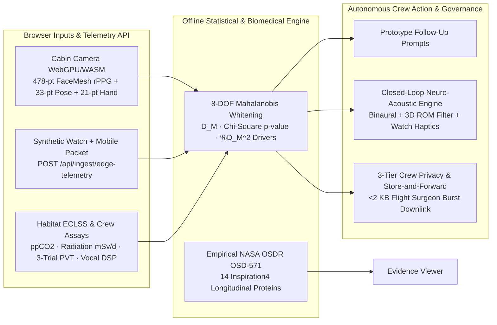

# AstroKinetics · ASTRA (`v5.1`) — 3D Crew Health Workstation, Watch + iPhone Companion, Grok Voice AI & Cited Evidence

[](https://astrokinetics-space-health-765428358644.us-central1.run.app)
[](https://astrokinetics-space-health-765428358644.us-central1.run.app/?tab=demo)
[](https://astrokinetics-space-health-765428358644.us-central1.run.app/?tab=triage)
[](https://astrokinetics-space-health-765428358644.us-central1.run.app/video)
[](https://astrokinetics-space-health-765428358644.us-central1.run.app/docs)
[](./LICENSE)
[](https://osdr.nasa.gov/bio/repo/data/studies/OSD-571)

> **2026 NASA International Space Apps Challenge (Houston, TX Local Event — Team AI-MED 01)**  
> **Challenge:** *Create Health Monitoring Software for Astronauts on Space Missions*  
> **Live Unified Showcase & Cloud Run Portal:** https://astrokinetics-space-health-765428358644.us-central1.run.app  
> **Project Overview & Verification:** https://astrokinetics-space-health-765428358644.us-central1.run.app/project · [2-Min Judge Kit](https://astrokinetics-space-health-765428358644.us-central1.run.app/for-judges) · [Live Verification JSON](https://astrokinetics-space-health-765428358644.us-central1.run.app/api/verification-report) · [AI Dossier (`llms.txt`)](https://astrokinetics-space-health-765428358644.us-central1.run.app/llms.txt) · [Public MCP (`/api/mcp/`)](https://astrokinetics-space-health-765428358644.us-central1.run.app/api/mcp/)  
> **29-second demo:** [Watch on YouTube](https://www.youtube.com/watch?v=RVlS16JRnv4) · [Portal video and transcript](https://astrokinetics-space-health-765428358644.us-central1.run.app/video)  
> **Direct Routes:** `/` *(Live 3D Twin workstation)* · `/project` *(overview & verification)* · `/for-judges` *(2-min judge kit + downloadable checklist)* · `/scenarios` *(4 mission scenarios)* · `/data` *(4 empirical NASA data notes)* · `/guides` *(4 technical architecture guides)* · `/?tab=demo` *(14-step Watch + iPhone companion)* · `/?tab=triage` *(3D Crew Body Map, red-flag triage, episodes, LiDAR)* · `/?tab=evidence` *(cited evidence engine)* · `/story` *(orbital story)* · `/video` *(demo video)* · `/feed.xml` *(RSS)*

[Prototype verification](#prototype-verification) documents the `v5.3.0` post-submission verification and Auto-RSI SEO/GEO build (updated November 21, 2026), including offline scoring parity, offline privacy redaction, NASA HUNCH safety rules, ASTRA episode governance, LiDAR tetrahedral volumetry, telemetry isolation, bundled NASA data integrity checks, 16 non-JS direct-answer discovery pages, and a public read-only MCP endpoint (`/api/mcp/`).

**What is new in `v5.1`:** the workstation is the front door and the Watch + iPhone companion is one of its tabs; the Triage tab opens with a 3D anatomical **Crew Body Map** (skeleton, heart, arteries, muscles) carrying live sensor callouts, a heartbeat-synced pulse wave and an Earth / Orbit gravity fluid-shift view; the Evidence tab draws the corpus as a constellation that lights up the sources behind each answer; the voice assistant picks a working microphone and speaker and takes turns hands-free. The pulse wave and gravity view are illustrations on real anatomy, not simulations.

---

## 1. Mission & Judge Showcase Architecture (`v5.0.0`)

During Artemis lunar surface operations, Mars transit (**up to 22-minute one-way / 44-minute round-trip communication delay**), and two-week solar-conjunction blackouts, astronauts cannot depend on real-time Earth flight surgeons. **AstroKinetics · ASTRA** unifies an easy-to-digest orbital story with real multimodal sensing and voice-first autonomy:

1. **Cinematic 3D Orbital Showcase (`/`, `#mission`, `0:29` Film) & 14-Step Apple Watch + iPhone Demo (`/demo/#demo`):**
   - Walks judges through *"Your normal changes when you leave Earth"* — 14-day personal baselines (224 readings), Orbit mode threshold adaptation, Mission Day 12 drift & SANS / headward fluid shift follow-up, and synchronized Watch-to-iPhone haptic/screen interaction (with Auto-Play and optional live Grok Voice narration).
2. **Smart Multi-Turn Grok Voice AI powered by `clawagents_py` (`/api/voice/status`, `/api/voice/chat`, `/api/voice/tts`):**
   - Floating 60-FPS plasma voice copilot across every view (`/`, `/demo/`, `/studio`) backed by `clawagents` (`clawagents==6.20.101`) + xAI `grok-4.20-0309-non-reasoning` with domain tools (`get_astronaut_state`, `run_hunch_triage_check`, `lookup_nasa_evidence`, `control_portal_ui`) and xAI Grok Voice neural speech (`eve`, `ara`, `rex`, `leo`, `lumen`) supporting live portal navigation and Web Speech crew microphone input.
3. **6-Language Instant Switching (`EN`, `ES`, `FR`, `JA`, `ZH`, `DE`):**
   - Synchronizes UI copy across `/`, `/demo/`, and `/studio` with Grok LLM responses and native xAI Grok Voice TTS accents (`en`, `es`, `fr`, `ja`, `zh`, `de`).
4. **Live 3D Biomechanics, HUNCH Safety Gate, LiDAR Volumetry & AURA Lab (`/studio`):**
   - **Adaptive Multi-Zone On-Device 3D Vision (`FaceMesh 478-pt` + `WorldPose 33-pt` + `Hands 21-pt`)** with 100% zero-cloud camera privacy, **Interactive 3D Musculoskeletal Twin with Pre-Flight `1g` Baseline Ghost**, **8-DOF Multivariate Mahalanobis ($\Sigma^{-1/2}$) Triage & Empirical NASA `OSD-571` Proteomics**, **NASA HUNCH 8-Red-Flag Safety Gate**, and **Closed-Loop Neuro-Acoustic Therapy & Connected Watch/Mobile API**.

---

## 2. System Architecture



---

## 3. Official NASA Datasets & Standards Integrated

| Official Resource | Integration in AstroKinetics |
| :--- | :--- |
| **NASA OSDR `OSD-571` (`GLDS-563`)** | The [Inspiration4 plasma study](https://osdr.nasa.gov/bio/repo/data/studies/OSD-571) provides research context. The bundled evidence asset serves 14 protein entries across 4 crew (`C001–C004`) and 6 timepoints (`L-92` to `R+82`) through `/api/osdr-empirical`. The scoring model uses a fixed demo reference. |
| **NASA OSDR RadLab (ISS DosTel)** | 164 bundled empirical ISS DosTel1/DosTel2 absorbed dose-rate and orbital pass observations (`2022-04-01` to `2022-04-02`) served through `/api/aura/radlab`. |
| **[`NASA-STD-3001` Vol. 2 Rev. F](https://standards.nasa.gov/node/237)** | Requirement V2 6004 sets a 3 mmHg one-hour mean cabin CO₂ limit. The prototype evaluates snapshot values using its own review thresholds. |
| **NASA PMC Space Biology Corpus & AURA** | 673 offline-searchable evidence items (572 NASA PMC publications, 70 reviewed sources, 16 bilingual concepts, 15 Apple biomarker studies) via `/api/aura/overview` and `/api/aura/search`, with strict `human_only=true` filtering separating rodent/cellular studies from human guidance. |
| **Barger et al. (2014) & NASA NLSP** | Published Shuttle/ISS actigraphy sleep tables ([PMC4188436](https://pmc.ncbi.nlm.nih.gov/articles/PMC4188436/)) informing Earth-1g vs. microgravity sleep triage context, plus NASA NLSP `AP005` & `DSO 484` metadata manifests. |
| **NASA HRP / HUNCH & CSA Bio-Monitor** | Deterministic 8-red-flag safety gate (`/api/hunch/catalog`), ExMC store-and-forward privacy model, and [ISS Bio-Monitor](https://www.nasa.gov/mission/station/research-explorer/investigation/?#id=7392) wearable schema. |

---

## 4. Quick Start (Run Locally or Offline)

```bash
cd webapp
python3 -m venv .venv && source .venv/bin/activate
pip install -r requirements.txt
uvicorn app:app --host 0.0.0.0 --port 8080
```

Then open `http://localhost:8080` (and `http://localhost:8080/docs` for interactive OpenAPI documentation). After an online visit and service worker activation, the workstation can reload its cached shell and run the scripted scenario scorer in the browser. Server APIs and cloud voice depend on their respective services.

### Prototype verification

**Post-submission software verification, updated November 21, 2026 (`v5.2.0`).** In the cabin-drift scenario, the crew sees a 2.85 mmHg CO₂ snapshot and a 322 ms reaction-time result. The prototype flags the combination for review and prompts the crew to verify the cabin trend and repeat the task. Live read-only checks are exposed at `GET /api/verification-report` (7/7 check groups passing), and the local CLI suite exercises 7 end-to-end suites:

| Scripted mission case | Server and cached offline browser | Mahalanobis $D_M$ |
| :--- | :--- | :--- |
| Nominal lunar orbit (`nominal_lunar`) | Nominal · 99.2/100 | 0.73 |
| Cabin CO₂ drift (`hypercapnia_drift`) | Watch · 78.3/100 | 3.85 |
| Musculoskeletal asymmetry (`musculoskeletal_asymmetry`) | Alert · 44.7/100 | 6.99 |
| Solar particle event blackout (`spe_blackout`) | Alert · 12.0/100 | 14.81 |

Automated regression checks (`node scripts/verify_judging_workflow.mjs http://127.0.0.1:8080`) verified 7/7 suites:
1. **Statistical parity (20/20):** All 4 mission scenarios plus 16 domain-boundary vectors match exactly between Python (`scipy.stats.chi2`) and browser JS (`static/dsp.js`) on `readiness_score`, `mahalanobis_d`, `mahalanobis_d2`, `p_value`, and `top_attributions`.
2. **Crew privacy redaction (4/4):** `cmo_operational` and `flight_surgeon_packet` redact `mood_score_10` and `private_journal_note` during non-alert states and escalate only an encrypted safety flag on `alert` (online and offline).
3. **NASA HUNCH safety gate (10/10):** All 8 emergency red flags return `EMERGENCY` even under poor/missing capture; degraded non-red-flag capture abstains (`INCOMPLETE_CHECK_REQUIRED`) and audits ML comparator disagreement; 5.9 h sleep shifts from `MODERATE` (`earth_1g`) to `LOW` (`mission_microgravity`) per Barger et al. (2014).
4. **ASTRA episode state machine (6/6):** Notification dismissal preserves `pending`; bad capture sets `repeat_required`; premature closure returns HTTP `409`; offline sync queues and online sync separates `remote_received` from `human_reviewed` idempotently; empty closure rationale returns HTTP `422`.
5. **LiDAR tetrahedral volumetry (3/3):** A closed 10×10×10 cm cube evaluates to `1000.0 mL` (0.00% analytical error, `PASS`); `<82%` coverage and ARKit `personSegmentationWithDepth` both trigger `QUALITY_HOLD`.
6. **Crew/Sol telemetry API isolation (5/5):** Synthetic Watch and Mobile packets merge only within the same `(crew_member, mission_sol)`, isolate other crew and days, report `received_channels` vs `demo_default_channels`, return `WKHapticType` cues, and reject out-of-range inputs (`HR = 500`) with HTTP `422`.
7. **Bundled NASA data, AURA guardrails & SEO/GEO routes (5/5):** Verified all 14 OSD-571 protein fold-changes against raw `log10` intensities, 164 RadLab ISS DosTel rows, 7 Barger sleep tables, 673 AURA indexed documents, strict `human_only=true` filtering, `/api/verification-report`, `/project`, `/video`, `/llms.txt`, `/llms-full.txt`, `/robots.txt`, and `/sitemap.xml`.

With a fresh local server running, run this command from `webapp` using Node.js 24:

```bash
node scripts/verify_judging_workflow.mjs http://127.0.0.1:8080
```

To reproduce the offline check, load `/?scenario=hypercapnia_drift`, wait for the service worker (`v5.2.0`) to activate, switch Chrome DevTools to Offline, and reload. The trajectory should display “Offline edge triage” with the same Watch status and 78.3 readiness index.

The scores are prototype indices derived from a fixed reference and simulated inputs. Clinical accuracy, flight readiness, performance on representative in-flight data, and native iOS/watchOS capture remain unverified.

---

## 5. License & AI / Open-Source Transparency

- Released under the OSI-approved **MIT License** ([`LICENSE`](./LICENSE)).
- Client-side neural landmark detection uses open-source Google `@mediapipe/tasks-vision` (`FaceLandmarker`, `PoseLandmarker`, `HandLandmarker`) executing locally in WebAssembly/WebGPU. The Python and browser scorers use the same covariance whitening transform. AI coding/documentation assistance and presentation media tools (Gemini / Claude Code / Veo 3.1 / Grok Voice TTS) are disclosed on the Space Apps submission portal.

---

## Credits, third-party material and licensing

- **AstroKinetics application code** (this repository, unless listed below): MIT, see [`LICENSE`](./LICENSE).
- **ASTRA companion material** — the orbital story, the Watch + iPhone guided demo, the 29-second ASTRA film and the knowledge bundle — was contributed by Carlos Jaimes and the ASTRA team for the joint Team AI-MED 01 submission and is released here under the same **MIT License**.
- **3D anatomy model** — BodyParts3D 4.0, © The Database Center for Life Science, **CC BY 4.0**, via the Human Atlas project (MIT). See [`webapp/static/atlas/ATTRIBUTION.md`](./webapp/static/atlas/ATTRIBUTION.md).
- NASA data and scientific sources are listed in the sections above and in the portal's Evidence tab.
