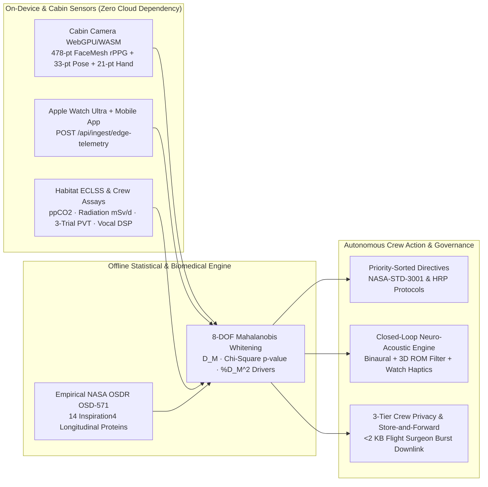

# AstroKinetics (`v3.4.0`) — Autonomous 3D Neuromotor, Multi-Sensor & Neuro-Acoustic Crew Health Suite

[](https://astrokinetics-space-health-765428358644.us-central1.run.app)
[](https://astrokinetics-space-health-765428358644.us-central1.run.app/docs)
[](./LICENSE)
[](https://osdr.nasa.gov/bio/repo/data/studies/OSD-571)

> **2026 NASA International Space Apps Challenge (Houston Local Event)**  
> **Challenge:** *Create Health Monitoring Software for Astronauts on Space Missions*  
> **Live Zero-Install Web App & Edge Hub:** https://astrokinetics-space-health-765428358644.us-central1.run.app

---

## 1. Mission Overview

During Artemis lunar surface operations, Mars transit (**up to 22-minute one-way / 44-minute round-trip communication delay**), and two-week solar-conjunction blackouts, astronauts cannot depend on real-time Earth flight surgeons. **AstroKinetics** is an offline-capable Progressive Web App (PWA) and wearable/mobile REST telemetry hub that lets crew **gather**, **evaluate offline**, and **act immediately** on covariant physiological and habitat drift.

### Key Innovations
1. **Adaptive Multi-Zone On-Device 3D Vision (`FaceMesh 478-pt` + `WorldPose 33-pt` + `Hands 21-pt`):**
   - Automatically detects whether the crew member is seated close at a cabin terminal (**478-point Cranio-Facial Mesh, 3-Zone Forehead/Malar Wang POS-rPPG, Ocular `EAR`/`PERCLOS` drowsiness, 3D Head Pose & Facial Symmetry**), holding up hands (**21-Joint 4–12 Hz Tremor & Finger-Tap Assay**), waist-up (**Upper-Body 3D Goniometry**), or standing (**Full-Body 3D ARED Squat Kinematics** with 1-Euro jitter stabilization).
   - **100% Zero-Cloud Privacy:** Raw camera frames never leave local RAM.
2. **Interactive 3D Musculoskeletal Twin with Pre-Flight `1g` Baseline Ghost:**
   - 60-FPS 3D biomechanical viewport with dual force-plate ground-reaction vectors (`GRF`), `%MVC` muscle-activation heatmap, recorded 62-frame motion-capture benchmark playback, and a **What-If Digital Twin** superimposing a translucent **Cyan Pre-Flight 1g Baseline Ghost** (`ΔDRIFT`, `ΔROM`, `ΔTILT`).
3. **8-DOF Multivariate Mahalanobis ($\Sigma^{-1/2}$) Triage & Empirical NASA `OSD-571` Proteomics:**
   - Computes Cholesky-whitened Mahalanobis Distance ($D_M$), 8-DOF $\chi^2_8$ survival $p$-values, and per-channel variance attributions (`%` of $D_M^2$) to separate **cabin `ppCO2` hypercapnia** from **microgravity musculoskeletal asymmetry** and **Solar Particle Event (`SPE`) radiation prodrome** — anchored to downloaded **NASA OSDR `OSD-571` (`GLDS-563`)** SpaceX Inspiration4 astronaut plasma proteomics.
4. **Closed-Loop Neuro-Acoustic Therapy, Vocal Stress DSP & Connected Watch/Mobile API:**
   - Synthesizes 4 real-time WebAudio protocols (`16 Hz Beta Motor RAS`, `10 Hz Alpha / 0.10 Hz Mayer-Wave HRV`, `40 Hz Gamma Vigilance`, `2.5 Hz Delta + 1/f Pink-Noise Storm Shelter`) modulated by live 3D joint ROM, Boersma vocal jitter/HNR analysis, spoken Flight Surgeon briefings, and live `POST /api/ingest/edge-telemetry` fusion returning `WKHapticType` Apple Watch wrist cues.

---

## 2. System Architecture



---

## 3. Official NASA Datasets & Standards Integrated

| Official Resource | Integration in AstroKinetics |
| :--- | :--- |
| **NASA OSDR `OSD-571` (`GLDS-563`)** | Downloaded SpaceX Inspiration4 astronaut longitudinal plasma proteomics (`CAT 5.24x`, `PRDX2 5.09x`, `HBA1 4.36x`, `TLN1 2.36x`, `C3 0.67x`, `FN1 0.17x`) across `L-92` to `R+82` + live `/api/nasa-osdr` REST verifier. |
| **`NASA-STD-3001` Vol. 1 & Vol. 2** | Habitat `ppCO2 < 2.0 mmHg` threshold, sleep/circadian target (`>= 7.5 h`), cognitive PVT latency gates, and countermeasure checklists. |
| **NASA HRP / HRR Evidence Books** | Sensorimotor, Musculoskeletal (ARED loading), Acute Radiation (SPE water-wall shelter), and Behavioral Medicine risk models. |
| **CSA Bio-Monitor Wearable Schema** | Continuous wearable HR, HRV (RMSSD), SpO2, respiratory rate, and wrist tremor telemetry schema. |

---

## 4. Quick Start (Run Locally or Offline)

```bash
cd webapp
python3 -m venv .venv && source .venv/bin/activate
pip install -r requirements.txt
uvicorn app:app --host 0.0.0.0 --port 8080
```

Then open `http://localhost:8080` (and `http://localhost:8080/docs` for interactive OpenAPI documentation). After initial load, the Service Worker (`sw.js`) caches all application assets and empirical NASA `OSD-571` data for 100% offline operation.

---

## 5. License & AI / Open-Source Transparency

- Released under the OSI-approved **MIT License** ([`LICENSE`](./LICENSE)).
- Client-side neural landmark detection uses open-source Google `@mediapipe/tasks-vision` (`FaceLandmarker`, `PoseLandmarker`, `HandLandmarker`) executing locally in WebAssembly/WebGPU; statistical scoring (`SciPy` / JS Cholesky Mahalanobis), 1-Euro filtering, Wang POS-rPPG, Boersma vocal DSP, and WebAudio neuro-acoustic synthesis are deterministic mathematical implementations. AI coding/documentation assistance and presentation media tools (Gemini / Claude Code / Veo 3.1 / Grok Voice TTS) are transparently disclosed on the Space Apps submission portal.
